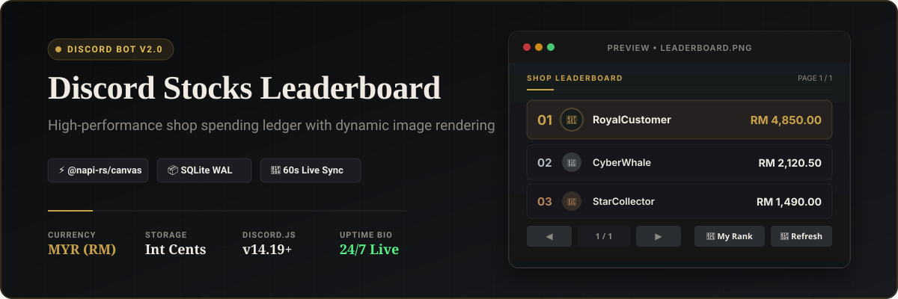

<p align="center">
  
</p>

<p align="center">
  <a href="#features">Features</a> •
  <a href="#architecture">Architecture</a> •
  <a href="#prerequisites">Prerequisites</a> •
  <a href="#installation--setup">Setup</a> •
  <a href="#custom-emojis">Custom Emojis</a> •
  <a href="#commands--usage">Usage</a> •
  <a href="#live-leaderboard">Live Mode</a>
</p>

---

## Overview

**Discord Stocks Leaderboard** is an automated customer spending tracker for Discord communities and online stores. Instead of standard text embeds, it dynamically renders a **retina-sharp (2x scale) ledger image** featuring custom profile avatars, ranking numerals, tiered medal highlights (Gold, Silver, Bronze), and formatted currency figures.

All currency is stored as integer cents in a fast SQLite database with Write-Ahead Logging (WAL), completely eliminating floating-point rounding errors.

---

## Features

- **Dynamic Canvas Rendering**: Generated via `@napi-rs/canvas` with letter-spaced typography, custom avatars, and high-DPI scaling.
- **Top 3 Medal Tiers**: Gold (`#caa24a`), Silver (`#b4b9c1`), and Bronze (`#b8825a`) accents for top spenders.
- **Atomic Currency Math**: Stored in integer cents (`RM 12.50` = `1250` cents). Zero drift when adding or subtracting amounts.
- **Interactive Navigation**: Prev, Next, Dynamic Page Indicator, Refresh, and private (ephemeral) "My Rank" check buttons.
- **Self-Updating Live Leaderboards**: Set up an auto-updating channel message with `/live start` that refreshes every 60 seconds whenever spending changes.
- **Bot Mention Trigger**: Simply send `@Bot` in any channel to view the leaderboard immediately.
- **Live Presence & Bio**: Real-time bot uptime status displayed on its profile and Developer Portal bio.

---

## Architecture

<p align="center">
  
</p>

1. **Commands / Triggers**: Discord slash commands (`/add`, `/set`, `/remove`, `/leaderboard`, `/live`) or a clean `@Bot` mention.
2. **Persistence**: `better-sqlite3` database running in WAL mode with prepared statements for atomic execution.
3. **Graphics Engine**: `@napi-rs/canvas` rasterizes user avatars, names, ranks, and currency into a clean PNG.
4. **Discord Interface**: Published with native button controls and optional custom application emojis.

---

## Prerequisites

- **Node.js**: v18.0.0 or higher
- **npm** or **yarn** / **pnpm**
- A Discord Application created in the [Discord Developer Portal](https://discord.com/developers/applications)

---

## Installation & Setup

### 1. Clone & Install Dependencies

```bash
git clone https://github.com/your-username/discord-stocks-leaderboard.git
cd discord-stocks-leaderboard
npm install
```

### 2. Configure Environment Variables

Create a `.env` file in the project root (refer to `env.example`):

```ini
# Discord Bot Token from Developer Portal
DISCORD_TOKEN=your_bot_token_here

# Client ID from Developer Portal (General Information)
CLIENT_ID=your_client_id_here

# (Optional) Test Guild ID for instant command registration during development
GUILD_ID=

# (Optional) Staff Role ID allowed to manage spending
STAFF_ROLE_ID=

# Store name displayed on the rendered leaderboard image
SHOP_NAME=STOCKS LEADERBOARD

# Timezone for timestamp display
TIMEZONE=Asia/Kuala_Lumpur

# Status text prefix for the bot's About Me bio
BIO_TEXT=Leaderboard Ranking
```

### 3. Configure Discord Bot Permissions

In the [Discord Developer Portal](https://discord.com/developers/applications):

1. Navigate to **Bot** -> Enable **Guilds** and **Guild Messages** intents.
2. Under **OAuth2** -> **URL Generator**:
   - Scopes: `bot`, `applications.commands`
   - Permissions:
     - `View Channels`
     - `Send Messages`
     - `Attach Files`
     - `Use External Emojis`
     - `Read Message History`
3. Invite the bot to your server using the generated URL.

---

## Custom Emojis

The bot supports custom white icon emojis for its interactive buttons. The source images are included in the `emoji/` folder:

| File | Emoji Name | Used On Button |
|---|---|---|
| `emoji/lb_prev.png` | `lb_prev` | Previous Page |
| `emoji/lb_next.png` | `lb_next` | Next Page |
| `emoji/lb_rank.png` | `lb_rank` | My Rank |
| `emoji/lb_refresh.png` | `lb_refresh` | Refresh |

### How to install:
1. Open the [Discord Developer Portal](https://discord.com/developers/applications).
2. Select your application and open the **Emojis** tab on the left menu.
3. Upload each file from the `emoji/` folder and name them exactly: `lb_prev`, `lb_next`, `lb_rank`, `lb_refresh`.
4. If omitted, buttons automatically fall back to standard text labels.

---

## Commands & Usage

### Customer & General Commands

| Command | Description | Permission |
|---|---|---|
| `/leaderboard` | View the interactive spending leaderboard image. | Everyone |
| `@Bot` | Mentioning the bot directly triggers the leaderboard view. | Everyone |
| `[My Rank]` button | Privately displays your current rank and total spending. | Everyone |
| `[Refresh]` button | Reloads the current page with real-time data. | Everyone |

### Staff Management Commands

> Access requires **Administrator** server permission or the configured `STAFF_ROLE_ID`.

| Command | Syntax | Description |
|---|---|---|
| `/add` | `/add user:@Customer amount:250.00` | Adds RM to customer total spending. |
| `/set` | `/set user:@Customer amount:500.00` | Sets exact total. Setting `0` removes them. |
| `/remove` | `/remove user:@Customer amount:50.00` | Subtracts amount. Floored at RM 0. |

---

## Live Leaderboard

Create an automated, self-refreshing leaderboard in any announcement or shop channel:

```text
/live start
```

- Automatically synchronizes every 60 seconds whenever data changes.
- Safe message replacement: edits the existing image without flooding chat notifications.
- To cancel and remove: run `/live stop` in the target channel.

---

## Starting the Bot

### Development Mode

```bash
node src/index.js
```

### Production with PM2

```bash
npm install -g pm2
pm2 start src/index.js --name "discord-stocks-leaderboard"
pm2 save
```

Commands register automatically upon bot startup. For manual re-deployment:

```bash
npm run deploy
```

---

## License

MIT License. Feel free to customize and integrate into your community shop.
